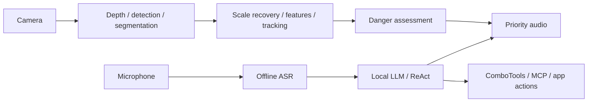

# TongXing (同行)

**On-device obstacle sensing and a voice agent on one Android phone.**

TongXing is an assistive-computing research prototype for visually impaired users. A phone runs local visual perception, speech recognition and language-model inference, while a tool layer connects spoken requests to navigation, travel queries and optional cloud descriptions.

[Project and demos](https://nihildigit.dev/tongxing/)

## What is implemented

- **SafetyCore:** depth estimation, object detection and semantic segmentation run in parallel. Ground-based scale recovery, appearance features, DeepSORT tracking and danger assessment turn their outputs into obstacle warnings.
- **AgentCore:** a local Qwen3-1.7B model runs a bounded ReAct loop. ComboTools organize MCP calls, short location IDs simplify references to search results, and stem-context caching reuses the system prompt and tool definitions.
- **Voice and application control:** offline Mandarin ASR, Android TTS, camera capture, accessibility actions and a foreground service share one application. Safety alerts take priority over assistant speech.
- **Runtime service configuration:** users enter their own MCP endpoints and optional cloud key in the app. Published builds start with empty credentials.

Vision targets Qualcomm Hexagon through QNN, language inference uses Adreno OpenCL, and ASR runs on the CPU. The repository includes the Android integration, Kotlin orchestration, C++ fusion code, model preparation tools and regression tests.



## Build and run

Use **JDK 21**, Git, [uv](https://docs.astral.sh/uv/) and Android SDK 36. Set `JAVA_HOME` and `ANDROID_HOME`. Gradle is pinned to 8.13. Install the required SDK packages:

```sh
sdkmanager "platforms;android-36" "build-tools;35.0.0" "build-tools;36.0.0" "ndk;27.0.12077973" "ndk;29.0.14206865" "cmake;3.22.1"
```

From the repository root:

```sh
uv run scripts/prepare_source_dependencies.py
uv run scripts/prepare_android_dependencies.py
uv run scripts/prepare_models.py --group vision --group asr --group llm
./gradlew :app:assembleDebug
```

On Windows, use `./gradlew.bat`. Model downloads total approximately 1.3 GB. The scripts retrieve pinned public artifacts and verify SHA-256 hashes. The MobileNetV2 feature model is generated automatically from its pinned classification model, with the compiler and schema versions recorded.

```sh
adb -s DEVICE_SERIAL install -r app/build/outputs/apk/debug/app-debug.apk
adb -s DEVICE_SERIAL shell mkdir -p /sdcard/Android/data/com.nihildigit.tongxing/files/models
adb -s DEVICE_SERIAL push build/models/Qwen3-1.7B-Q4_0-pure.gguf /sdcard/Android/data/com.nihildigit.tongxing/files/models/
```

In the app, complete setup and select the GGUF file, or use the model download/import screen. The app targets **Android 13+ and ARM64**. QNN and OpenCL operation has been tested on a OnePlus Ace 5 with Snapdragon 8 Gen 3; hardware and driver support determine accelerator availability on other devices.

For local debugging, copy `local.properties.example` to `local.properties`, fill in the service values, and run:

```sh
./gradlew :app:assembleDebug -PembedLocalServiceConfig=true
```

This opt-in flag embeds local service endpoints and credentials into debug builds only. Default builds and all release builds keep these values empty.

### Connect services

With the assistant stopped, open **Settings → Service connections**. Enter the HTTPS MCP URLs for the services you use, then save and start the assistant. An empty field disables that connection. The tool screen controls which capabilities are enabled.

The optional DashScope key enables cloud vision tools. Local perception, ASR and local LLM inference stay on the phone. MCP tools send their required parameters to configured services; cloud descriptions send the selected image to DashScope. See [security and data handling](SECURITY.md).

Core setup, dashboard and settings labels follow the system language: Simplified or Traditional Chinese, with English as the fallback. The supplied speech model, agent prompts and voice-command examples currently target Mandarin.

## Models and reproducibility

[models.lock.json](models.lock.json) pins file sizes, hashes, public download revisions and the feature-export recipe. Model licenses are listed in [THIRD_PARTY_NOTICES.md](THIRD_PARTY_NOTICES.md).

| Model | Role | Execution path |
|---|---|---|
| MiDaS V2 Small | Relative depth | TFLite / QNN |
| YOLOX Small | Object detection | TFLite / QNN |
| FFNet-78S-LowRes | Semantic segmentation | TFLite / QNN |
| MobileNetV2 pooled features | Appearance matching | TFLite / QNN |
| Qwen3-1.7B Q4_0 | Tool-using language agent | llama.cpp / OpenCL |
| Paraformer Chinese INT8 | Speech recognition | Sherpa-ONNX / CPU |

Model weights are downloaded separately from their public sources. A custom model must preserve the relevant preprocessing, tensor layout and output semantics.

## Tests and evidence

```sh
./gradlew :lightway_agentcore:android:agentcore:testDebugUnitTest
./gradlew :lightway_safetycore:safetycore-core:testDebugUnitTest
./gradlew :app:connectedDebugAndroidTest
```

The default device suite covers JNI numeric boundaries, model-file transactions, import ordering, service configuration and locale selection. Install both the application and test APKs before running device tests:

```sh
./gradlew :app:assembleDebug :app:assembleDebugAndroidTest
adb -s DEVICE_SERIAL install -r app/build/outputs/apk/debug/app-debug.apk
adb -s DEVICE_SERIAL install -r app/build/outputs/apk/androidTest/debug/app-debug-androidTest.apk
```

Model inference checks are opt-in. Prepare vision and ASR assets before building and push the GGUF model as shown above, then run:

```sh
adb -s DEVICE_SERIAL shell am instrument -w -e validateModels true -e class com.nihildigit.tongxing.LocalModelsValidationTest com.nihildigit.tongxing.test/androidx.test.runner.AndroidJUnitRunner
```

These checks require compatible Qualcomm QNN and Adreno OpenCL support. For service lifecycle checks, grant camera, microphone, foreground location and overlay access first. The test starts and stops the camera, vision, ASR and AgentCore components twice with local models and empty service endpoints:

```sh
adb -s DEVICE_SERIAL shell am instrument -w -e validateService true -e class com.nihildigit.tongxing.ServiceLifecycleValidationTest com.nihildigit.tongxing.test/androidx.test.runner.AndroidJUnitRunner
```

The native danger-assessment regression also runs on a development machine:

```sh
cmake -S lightway_safetycore/safetycore-core/src/test/cpp -B build/native-tests -DCMAKE_BUILD_TYPE=Release
cmake --build build/native-tests --config Release
ctest --test-dir build/native-tests -C Release --output-on-failure
```

On Snapdragon 8 Gen 3, SafetyCore measured **35.16 ms mean latency** and **47.07 ms P95** across 1,636 frames. The live application processes camera input at approximately 15 Hz.

## Source map

| Path | Responsibility |
|---|---|
| `app/` | Compose UI, foreground service, camera, audio and accessibility |
| `lightway_safetycore/safetycore-core/` | Pipeline orchestration, JNI, tracking and danger assessment |
| `lightway_safetycore/qnn-sdk/` | Preprocessing, model runners and delegate selection |
| `lightway_agentcore/android/agentcore/` | Router, conversation context, ComboTools and MCP clients |
| `third_party/llama.cpp/` | Pinned Android SDK fork, fetched during setup |
| `scripts/` | Dependency and model preparation scripts |

## License and contributions

Original TongXing source code and documentation use [Apache-2.0](LICENSE). Third-party code, runtimes and weights retain their own licenses and notices; see [THIRD_PARTY_NOTICES.md](THIRD_PARTY_NOTICES.md).

Contributions should include a focused explanation and relevant validation. Start with [CONTRIBUTING.md](CONTRIBUTING.md).
